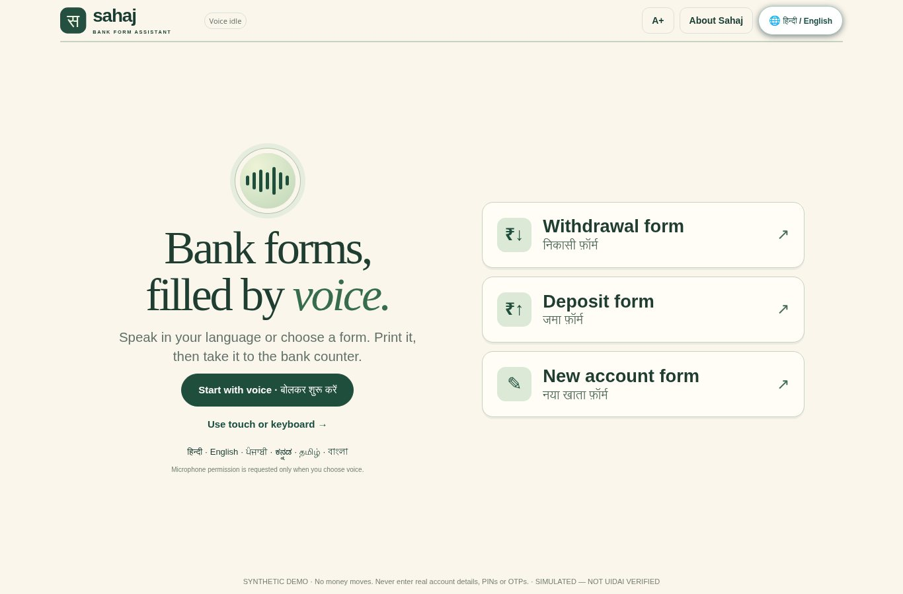
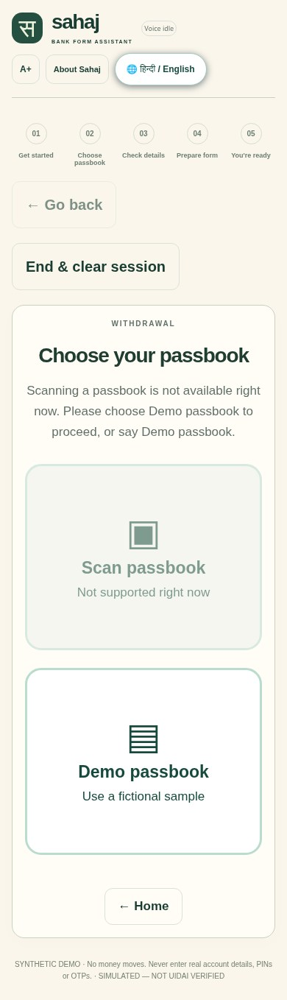

# Sahaj — Banking Made Simple

Sahaj is a multilingual banking kiosk prototype that helps customers prepare forms using voice or touch. Instead of filling in everything by hand, a customer can choose a service, review details taken from a demo document, and download a form to print and sign.

I built it for the **Gnani AI Great Indian Internship challenge**.

**[Read the one-page solution pitch (PDF)](docs/Sahaj_One_Page_Solution_Pitch.pdf)**

> This is a demonstration project. All customer records and documents are fictional. Sahaj does not access real bank accounts, transfer money, verify a customer's identity for a bank or submit account applications.

## Why I built it

Bank forms can be confusing, especially when a customer is more comfortable speaking in a regional language. People may also have to enter the same information several times, even when it is already on their documents.

Sahaj makes that process easier to follow: choose what you need, answer a few questions, check the details and take a prepared form to the counter.

## What it can do

- **Withdraw cash:** Choose Demo passbook. Sahaj loads a fictional sample automatically, checks the matching demo account balance and helps prepare a withdrawal form.
- **Deposit cash:** Choose Demo passbook to load a sample automatically, enter the amount and prepare a deposit slip.
- **Open a savings account:** Choose the demo Aadhaar option and follow the prompts. Sahaj loads the fictional identity sample automatically and can use a demo PAN sample when required. Bank staff would still need to complete real identity checks.
- **Speak or tap:** Use speech guidance when available, or continue with on-screen controls and a keyboard.
- **Choose languages:** Set the screen language and spoken language separately. Language availability varies across screens and speech services.
- **Review before downloading:** Check the information, see where to sign and follow directions to the appropriate counter.

The kiosk uses one predefined passbook for its normal demo. You do not pick from a gallery of customer passbooks. If the first sample cannot be loaded or read, Sahaj automatically tries one of two backup samples. The backups remain hidden from the customer. Physical passbook scanning is not available. Voice features need a working provider configuration and microphone permission.

## Screenshots

| Home screen | Demo passbook step (mobile) |
| --- | --- |
|  |  |

## How it works

1. Choose withdrawal, deposit or account opening.
2. Choose Demo passbook or Demo Aadhaar. Sahaj loads the sample automatically.
3. Check the account or application information shown on screen.
4. Confirm the details and preview the form.
5. Download the draft, sign the printed copy and follow the counter instructions.

The project uses **HTML, CSS and JavaScript** for the kiosk and **Python/FastAPI** for the backend. It uses OCR to read sample documents, SQLite for fictional account records, and PDF generation for forms. The speech integration includes **Gnani Prisma** (speech-to-text) and **Timbre** (text-to-speech), with alternative speech paths in the code.

## Run it locally

You will need Python 3.10 or newer, a modern browser and internet access to install dependencies. Some document-reading features require Windows OCR or Tesseract.

**On Windows:**

1. Download or clone the repository.
2. Copy `.env.example` to `.env`. Add your own Gnani API key if you want to test its speech service.
3. Run `START_KIOSK.bat`.
4. If the browser does not open, visit `http://127.0.0.1:8766`.

**Manual setup (Windows, macOS or Linux):**

```bash
python -m venv .venv
python -m pip install -r requirements.txt
python run_kiosk.py
```

Activate the virtual environment before installing packages, and copy `.env.example` to `.env` before starting the app. The included `Dockerfile` is another option for running the backend.

The `.env` file is private and should **never** be pushed to GitHub. `GEMINI_API_KEY` is optional and is only used for some fallback and document-reading features. There are no live banking credentials in this repository.

## Try the demo

Start with withdrawal: choose **Demo passbook** and Sahaj automatically loads the sample. Enter ₹500, check the balance and form details, then preview the form and download it. Try an amount above the fictional balance to see how the kiosk handles it. You can also switch between voice and on-screen input.

For savings-account opening, choose **Demo Aadhaar** to load the predefined sample. A fictional PAN sample is also available in the form flow.

The repository contains three matched sets of generated passbook, Aadhaar, PAN and identity-card images for testing, plus two backup versions of the account-opening Aadhaar and PAN samples. The full fictional database is retained. The kiosk always tries its default sample first; if it fails, Sahaj tries up to two alternatives automatically without displaying a selection gallery. A backup passbook may represent a different fictional demo account, and the kiosk verifies the matching account before continuing.

## Tests

```bash
python -m pip install -r requirements-dev.txt
python -X utf8 -m pytest -q
node --test tests/*.test.cjs
```

In the last test run on **15 November 2026**, 155 of 158 Python tests passed and all 29 JavaScript tests passed. Three Python tests still need review against changes to the interface (`test_v16_kiosk_contract.py`, `test_v8_navigation_contract.py` and `test_v9_kiosk_contract.py`). Automated tests do not confirm that a live microphone or speech service works on every device.

## Project files

| Location | Contents |
| --- | --- |
| `app/` | Backend services and provider connections |
| `static/` | Kiosk screens, scripts and styling |
| `data/` | Fictional account records and sample metadata |
| `scripts/` | Scripts for building sample data |
| `tests/` | Python and JavaScript tests |
| `docs/` | Screenshots and the one-page pitch |
| `main.py` | FastAPI application |
| `run_kiosk.py` | Local server launcher |

## What still needs work

Speech quality needs to be tested across accents and noisy spaces. Some translated messages also need further review. A real bank deployment would need approved bank connections, proper identity verification, security testing and a physical scanning setup.

**[One-page solution pitch](docs/Sahaj_One_Page_Solution_Pitch.pdf)**
